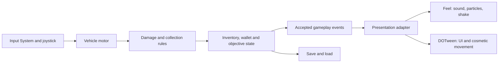

# Sprint 1 — use the installed tools in small steps

This is a proposed integration plan for the shared drive → break → collect → deliver → upgrade loop. It deliberately leaves the unresolved material counts, cargo sizes and objective choice to the authoritative game specification. Timings below are starting values for playtesting, not facts extracted from the reference game.

## Event flow

The presentation adapter may be disabled and the loop must still complete. Start with ordinary C# events or explicit method calls; no extra event-bus package is required. Subscribe once on enable and unsubscribe on disable. Avoid wiring both a code callback and an Inspector event to the same effect.

## A sensible implementation order

| Step | Deliverable | Exit condition |
|---|---|---|
| 1 | Open/compile exact baseline, one input route, safe-area HUD | No unresolved compiler error; desktop and touch input both work |
| 2 | Graybox movement, damage, cargo, depot transaction | Complete one round trip with all feedback disabled |
| 3 | One Feel hit and one break effect | Correct position; no feedback when damage is rejected |
| 4 | DOTween HUD pulse and panel transition | Interrupt/reopen/pause works without stale tween behavior |
| 5 | Delivery and upgrade feedback | Presentation cancellation cannot duplicate currency or purchases |
| 6 | Reuse/pooling and mobile check | Repeated loops remain bounded; no increasing effects/audio count |

Only then add optional screen-space particles, haptics or richer camera effects. A small reliable presentation set is enough to establish the first playable loop.

## Event-to-effect contract

| Accepted event | Presentation | Suggested initial tuning | Correctness constraint |
|---|---|---|---|
| `DamageApplied` | Feel: small dust burst + impact sound + visual-child scale pulse | ~0.08–0.14 s scale; subtle pitch variation | Fire after hit cooldown/range/health validation, not every physics callback |
| `DepositDestroyed` | Feel: larger debris + distinct break sound | ~0.2–0.4 s burst; optional very small shake | Emit once; break effect survives deposit pool return |
| `PickupAccepted` | DOTween cosmetic flight or icon pulse; Feel pickup tick | ~0.2–0.35 s flight, ~0.2 s icon pulse | Inventory grants once before animation; full-cargo rejection gives no success tick |
| `CargoBecameFull` | Clear HUD text/color and one mild cue | One pulse per transition into full | Do not repeat each frame; a text/icon signal must remain readable without motion |
| `DeliveryCommitted` | DOTween displayed count + Feel sale sound | ~0.3–0.5 s displayed-count change | Real inventory/wallet transaction already complete; interruption cannot lose money |
| `UpgradePurchased` | Feel confirmation + DOTween panel/icon response | ~0.25–0.5 s combined presentation | Apply stat and price once; disable/reject repeated purchase during same transaction |
| `GoalCompleted` | Short result panel with limited particles | ~0.4–0.7 s entrance | Save objective state before presentation; no infinite mandatory celebration |

Use an event payload containing the accepted result: world position, amount and relevant stable ID. A presentation listener should not calculate its own economy or damage outcome.

## Recipe A — drill impact

Create `DepositRoot` for collider/health and `DepositVisual` as its mesh child. Give Feel scale ownership of the visual child only. Use `MMF_ParticlesInstantiation` with Script position mode and call `PlayFeedbacks(hitPoint)` after damage succeeds. Choose Pool mode and one shared impact owner if many deposits use the same effect.

Start with a small adapted dust prefab. One existing candidate is `Assets/Epic Toon FX/Prefabs/Combat/Explosions (Misc)/HitDustExplosion.prefab`; selection is based on its presence/name, not a verified URP render. Inspect it first, make a game-owned variant, reduce counts/size and check its stop behavior. Use original game colors and a modest scale rather than importing the whole showcase scene.

On a rapid drill, throttle the cosmetic sound separately if necessary; this must not reduce legitimate damage. A denied visual replay due to Feel cooldown is acceptable. A denied gameplay hit because the visual player is busy is not.

## Recipe B — pickup and cargo display

The collector first asks inventory to accept an item. If accepted, remove/disable the physical pickup once and launch an independent cosmetic visual. Tween that visual toward a snapshot endpoint or update its tracking deliberately. Do not let its trigger collider remain active during the flight.

Use DOTween for the cargo icon's scale pulse, killing the previous owned pulse and restoring its baseline before replay. UI reward motion needs world-to-screen and screen-to-Canvas conversion with the correct camera; world coordinates are not RectTransform anchored positions.

If the HUD closes or the scene unloads, return/cancel the cosmetic object. The accepted resource remains in inventory. For a pooled visual, cancel its sequence before reassigning targets and clear callbacks/state from its previous use.

Particle Image can later provide small screen-space sparkles at the cargo counter. Its particle-finished events should only manage presentation, never authorize item grants.

## Recipe C — delivery transaction

The depot validates the actual cargo, commits one delivery transaction and publishes its accepted quantities and new balance. A presenter updates text immediately or animates a separate displayed count toward that value. New delivery events should replace/merge the visual count target without adding an extra transaction.

Use one sale sound and a short icon pulse. A floating `+amount` label can be implemented with an owned pooled TMP object and DOTween, or Feel's configured floating-text spawner. Pick one route.

Test by entering/exiting the depot rapidly, disabling the presentation object halfway, and leaving the scene during the count animation. Inventory/wallet results must match the same tests with all effects off.

## Recipe D — upgrade panel

Use a CanvasGroup and child RectTransform. DOTween owns panel fade/position. Update button availability from the actual wallet/upgrade state; faded visuals alone do not prevent clicks. Set `interactable` and `blocksRaycasts` explicitly for hidden panels.

For a paused menu, use unscaled UI animation and ensure the input route remains active. Restore panel baseline when closing/interrupted, then reopen from a known state. Trigger Feel success feedback only after the purchase commits. Use a different text/state for insufficient funds.

UIEffect `UIShiny` is optional for the upgraded icon. Let it own its material effect factor while DOTween owns a different property or child. Avoid stacking multiple material-modifying effects until masking and materials have been verified on device.

## Recipe E — camera and haptics, after the loop works

Use a follow root and separate shake child; wire a matching Feel receiver/channel. Disable the particle prefab's own camera shake if Feel is the chosen owner. Start with break/upgrade shake only. Avoid shaking on every collected resource.

A game-level haptic adapter should enforce the user's toggle, a short minimum interval, and platform support. Prefer one Nice Vibrations preset for break/upgrade; avoid continuous vibration in Sprint 1. Confirm the Android define and physical device output before considering this delivered.

## Data worth keeping game-owned

Create your own effect configuration assets/prefab variants under the game's folder. Store intensity, duration, pool cap and enabled/reduced-motion settings there. Avoid changing vendor examples or mixing game balance into Feel assets. Separate sound/particle variation from deterministic inventory and objective values.

First-sprint performance measurements should include frame time on the actual Android target, peak concurrent effects/audio sources, managed allocations during repeated hits, and memory after several delivery loops. No FPS or memory result is claimed by this pack.
